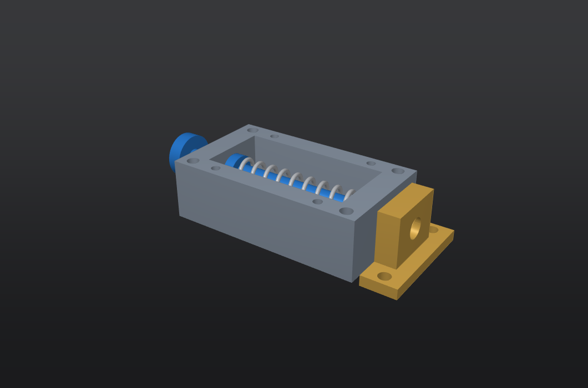
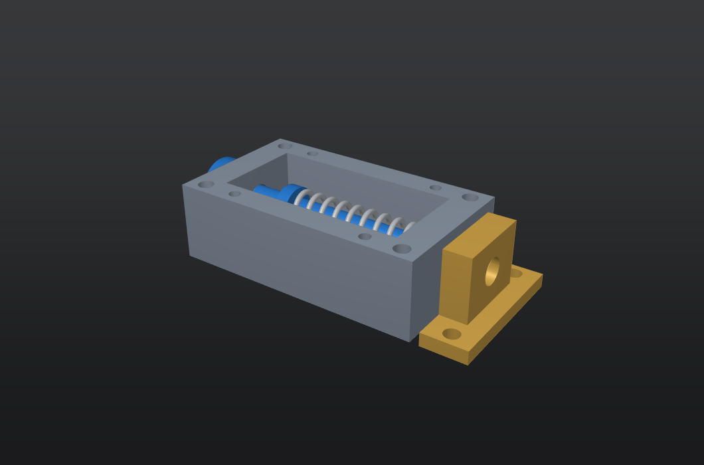

# 常开直推按钮锁扣

> **旧方案，未通过最终验收，已由 `../button_claw_latch/` 的按钮连杆旋转锁爪方案替代。**
> 本目录保留早期记录；下文历史“校验”不能视为完整设计检查合格。原生检查曾发现 5 个错误，包括四处螺丝包络干涉及扣座连接问题。

## 动作

本方案按用户选择采用 **按住锁闭，松开自动打开**，不是按一下自锁、再按一下解锁。

蓝色按钮与锁舌为同一个运动件，沿 X 轴移动。按压按钮 8 mm，锁舌插入金色扣座；松开后由压缩弹簧推动锁舌退出。扣座应安装在另一块待锁合的面板上，不能与底座安装在同一块不可分离的板上。

这是用于确认结构和安装关系的概念样机。尺寸为本次设计值，尚未按载荷、安装空间、寿命或生产工艺定型，不是已验证可投产的安全锁具。

## 在 GenForm 中打开

| 文件 | 状态 |
| --- | --- |
| `button_latch_open.gasm` | 默认常开、锁舌缩回 |
| `button_latch_pressed.gasm` | 按下 8 mm、锁舌进入扣座 |
| `button_latch_exploded.gasm` | 上盖和四颗螺丝抬起，便于观察内部 |

装配使用同目录的 `.gform` 零件文件，请保留相对目录关系。上盖可在装配树中隐藏以观察弹簧与锁舌。开闭文件是两个静态配置，弹簧不是实时弹性仿真。

## 已导出的视图与实体

- `button_latch_open.png`：常开内部视图。
- `button_latch_pressed.png`：按钮按下后的内部视图。
- `button_latch_exploded.png`：上盖和螺丝抬起的爆炸图。
- `button_latch_open.step`、`button_latch_pressed.step`：完整装配的 STEP 实体，包含截图中为方便观察而隐藏的上盖和螺丝。
- `presentation.json`：记录截图时实际加载的装配路径、锁舌网格包围盒、弹簧位置和图片 SHA-256。

展示脚本不再以“等待 1 秒”判断加载完成，而是核对装配文件、零件摆放、锁舌和弹簧网格是否与目标状态一致。导出还会检查文件确实更新；开闭图片相同会报错，不会当作成功。





## 尺寸与组成

单位：mm。

| 项目 | 本次设计值 |
| --- | --- |
| 底座外形 | 56 × 32 × 17 |
| 上盖厚度 | 2 |
| 锁舌轴线高度 | 10 |
| 按钮直径 / 厚度 | 13 / 4 |
| 锁舌直径 | 5 |
| 锁舌导向孔直径 | 5.6；径向间隙 0.3 |
| 扣座孔直径 | 5.8；径向间隙 0.4 |
| 按钮行程 | 8 |
| 常开时锁舌尖端 / 扣座入口 X | 26 / 30，脱开距离 4 |
| 按下时锁舌尖端 X | 34，进入扣座 4 |
| 底座与扣座间隙 | 2 |
| 底座安装孔 | 4 × Ø3.4，中心 (±24, ±13) |
| 扣座安装孔 | 2 × Ø3.4，中心 (35, ±13) |
| 上盖紧固 | 4 × M3×6 盘头内六角螺丝 |
| 上盖螺丝中心 | (±16, ±13) |
| 弹簧线径 / 中径 / 圈数 | 1.2 / 8.2 / 9 |
| 弹簧安装空间 | 常开约 39，按下约 31 |

底座后壁与锁舌轴肩形成常开端限位；按钮内侧与底座后端面形成按下端限位。按钮后移位置已修正，避免按下行程尚未到 8 mm 就撞到底座。

## 零件文件

- `housing.gform`：底座、滑动导向和安装孔。
- `button_bolt.gform`：按钮、锁舌和弹簧反力轴肩。
- `keeper.gform`：独立扣座。
- `cover.gform`：检修上盖，外观以浅蓝色区分，不代表已选定透明材料。
- `cover_screw_M3x6.gform`：上盖螺丝，共装配四颗。
- `spring_open.gform`、`spring_pressed.gform`：弹簧的两种安装长度。

## 校验与限制

`verification.json` 记录了实体有效性、两种装配状态和 0～8 mm 每 1 mm 的刚性件行程检查。

- 7 份零件文件的 BRep 实体有效。
- 两个状态各检查 36 对零件；未发现预期螺纹包络以外的体积干涉。
- 9 个行程位置中，锁舌与底座、扣座没有体积干涉。采样不是连续碰撞证明。
- 螺丝为无牙简化模型，底座仅建 M3 底孔，四处螺纹连接出现的包络重叠已明确单列，不算作“完整螺纹零干涉”。
- 螺旋弹簧端部尚未做闭口磨平。实际采购或制造时需设计端部支承、预压及弹簧刚度，保证克服滑动摩擦后仍能可靠完全复位；当前模型没有验证回位力。
- 未计算锁舌剪切强度、按钮操作力、磨损、疲劳或抗振性能。没有载荷要求前，不给出安全承载额定值。
- 安装螺栓、面板与配套螺母取决于实际安装厚度，本次未选型或装配。

## 重建与复查

先启动 GenForm，然后在项目根目录使用项目 Python 环境运行：

```powershell
C:\qt_project\venv313\Scripts\python.exe -B examples\button_latch\build.py core
C:\qt_project\venv313\Scripts\python.exe -B examples\button_latch\build.py springs
C:\qt_project\venv313\Scripts\python.exe -B examples\button_latch\build.py assembly
C:\qt_project\venv313\Scripts\python.exe -B examples\button_latch\build.py show
C:\qt_project\venv313\Scripts\python.exe -B examples\button_latch\verify.py
C:\qt_project\venv313\Scripts\python.exe -B examples\button_latch\present.py
C:\qt_project\venv313\Scripts\python.exe -B -m unittest tests.test_button_latch_presentation
```

零件通过软件的 MCP 命令创建并保存特征历史；已存在的零件会跳过，避免误覆盖手工修改。装配文件按 GenForm 的原生 `.gasm` 格式组织。

`present.py` 更新开闭视图和 STEP，最后在软件中停留在常开状态并隐藏上盖及其螺丝。5 项展示脚本回归测试覆盖旧锁舌网格等待、旧弹簧网格拒绝、旧导出文件拒绝、导出失败和新导出文件验收。
